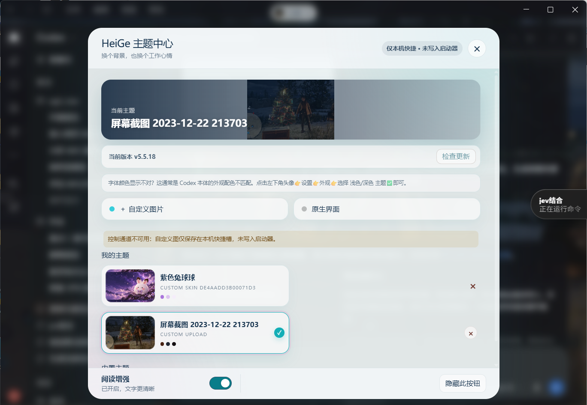
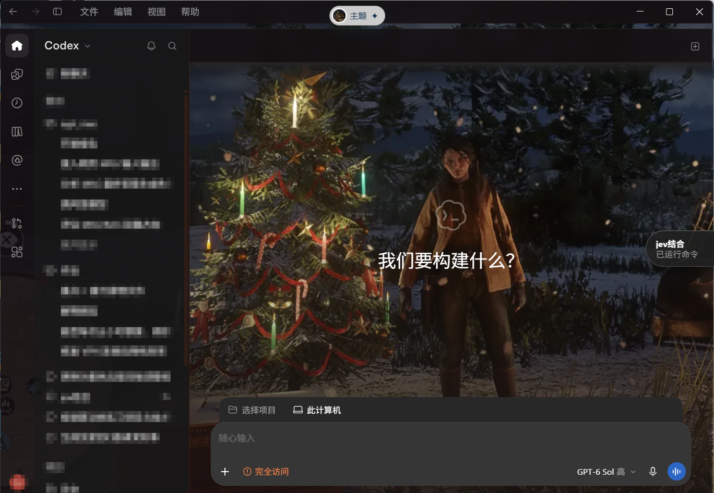

# Codex 主题壁纸 Skill · Codex Theme Wallpaper

A reusable Skill for image wallpaper themes **inside Codex Desktop for Windows**. The purple Bunbun image is the included example; you can choose or generate other wallpapers. The Skill checks whether the installed Codex build can set an image background natively and repairs readability with local blur and contrast adjustments.

## What the Skill does

- Checks the installed Codex version and its actual Appearance controls for native image-background support. It tests image rendering and restart persistence when that control exists; absence is reported for that build only.
- Uses the included image, a user-provided image, or an image generated from the user's description when an image-generation tool is available.
- Lets you choose another supported local image in HeiGe's theme center and switch between custom image themes. Each switch is checked for readability and restart persistence.
- Applies the image through a native setting when available, or through a separately reviewed HeiGe installation. It verifies the visible result and persistence.
- Audits the top bar, message text, composer, edit form, dialogs, and narrower layouts. It adds translucent blur and stronger text contrast only where the wallpaper makes content hard to read.

## Demo / 效果预览

*Screenshot from Codex Desktop on Windows. Conversation titles in the sidebar are blurred.*

## Change the wallpaper / 更换壁纸

**可以在主题里任意换壁纸。** Open **主题 → ＋ 自定义图片**, choose a supported local PNG, JPG/JPEG, or WebP image, and select the new custom theme. You can switch images without recreating the bundled Bunbun artwork. A new image may change the theme palette, so check the text and blur overlays again. See the [switching guide](references/switch-wallpaper.md).

The first screenshot shows **仅本机快捷・未写入启动器**. It demonstrates image switching, while restart persistence still needs separate verification. The second screenshot shows the image visibly applied; the pictured game artwork is an example screenshot, not a wallpaper asset bundled by this repository.

## Use

Install this repository as a Codex Skill, or copy `SKILL.md`, `agents/`, `references/`, and `assets/` into a `codex-theme-wallpaper` folder under your Codex skills directory. Invoke `$codex-theme-wallpaper` to apply the included purple Bunbun wallpaper or describe a new image to create and apply. The Bunbun wallpaper image is [included here](assets/purple-bunbun-wallpaper.png).

The Skill uses the separately installed HeiGe Codex Skin Studio as its theme engine. This repository does not bundle or claim ownership of that tool. Review its source and installer before using it.

## Search terms / 搜索关键词

Codex Desktop wallpaper · Codex theme wallpaper · Codex skin · Codex Skill · custom image wallpaper · purple Bunbun wallpaper · purple rabbit theme · Windows Codex customization · Codex 主题壁纸 Skill · Codex 壁纸 · Codex 主题 · 紫色兔球 · 兔球球背景

This is an unofficial customization. It relies on the current Codex Desktop page structure and may need adjustment after app updates. The wallpaper is a custom generated illustration from this conversation, not an official game asset.
