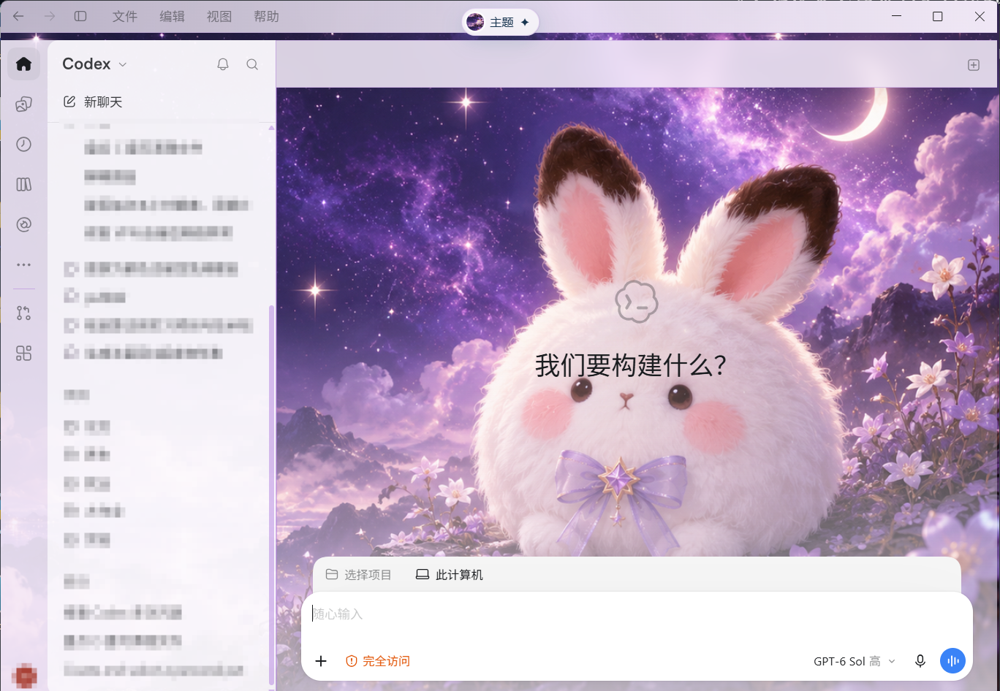

# Codex purple Bunbun wallpaper

A purple Bunbun image wallpaper **inside Codex Desktop for Windows**, packaged as a reusable Codex Skill. The theme also includes fixes for title-bar contrast, the composer fade when the sidebar collapses, and text readability while editing a sent message.

## Demo / 效果预览

*Screenshot from Codex Desktop on Windows. Conversation titles in the sidebar are blurred.*

## Use

Install this repository as a Codex Skill, or copy `SKILL.md`, `references/`, and `assets/` into a `codex-bunbun-wallpaper` folder under your Codex skills directory. Then ask Codex to apply the purple Bunbun wallpaper. The wallpaper image is [included here](assets/purple-bunbun-wallpaper.png).

The Skill uses the separately installed HeiGe Codex Skin Studio as its theme engine. This repository does not bundle or claim ownership of that tool. Review its source and installer before using it.

## Search terms / 搜索关键词

Codex Desktop wallpaper · Codex theme · Codex skin · Codex Skill · purple Bunbun wallpaper · purple rabbit theme · Windows Codex customization · Codex 壁纸 · Codex 主题 · 紫色兔球 · 兔球球背景

This is an unofficial customization. It relies on the current Codex Desktop page structure and may need adjustment after app updates. The wallpaper is a custom generated illustration from this conversation, not an official game asset.
